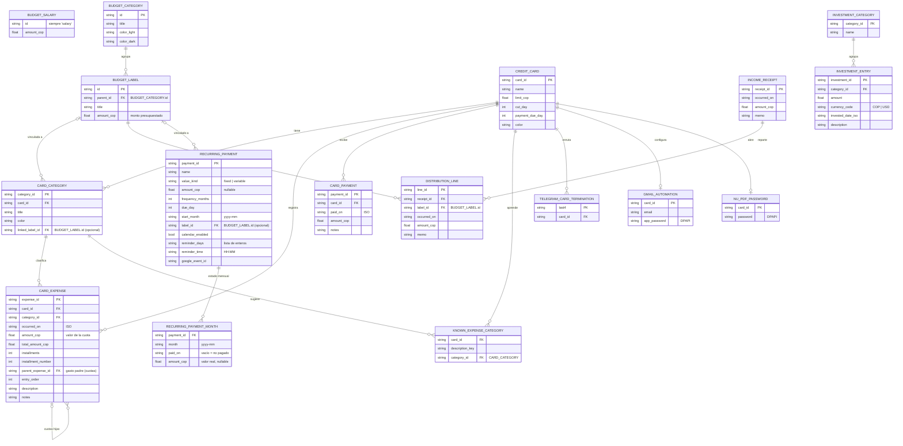

# Modelo de datos

Finanmind no usa una base de datos relacional: todo vive en archivos dentro de la carpeta de trabajo del usuario (`AppConfig.USER_DATA_ROOT`). Cada CSV de dominio es una **tabla única con filas tipadas**: la columna `record_type` dice qué entidad hay en cada fila. Las relaciones son **lógicas** (por id en texto); ningún componente garantiza integridad referencial.

## Diagrama entidad-relación

La **etiqueta de presupuesto** (`BUDGET_LABEL`) es el eje del modelo: las categorías de tarjeta, las líneas de distribución y los pagos recurrentes apuntan a ella. Así el dashboard compara lo presupuestado con lo gastado y con lo pagado.

## Archivos y entidades

| Archivo | `record_type` → entidad | Codec / store |
|---|---|---|
| `budget.csv` | `salary`, `category`, `label` | `budget/csv_codec.py` |
| `credit_cards.csv` | `card`, `category`, `expense`, `payment` | `repositories/credit_card_csv_codec.py` |
| `monthly_distribution.csv` | `income`, `allocation` | `repositories/monthly_distribution_csv_codec.py` |
| `investments.csv` | `category`, `investment` | `repositories/investment_csv_codec.py` |
| `recurring_payments.csv` | `payment`, `month` | `repositories/recurring_payment_csv_codec.py` |
| `known_expense_categories.csv` | (tabla plana) `card_id, description_key, category_id` | `services/known_expense_category_store.py` |
| `telegram_card_terminations.json` | `last4 → card_id` | `services/telegram_card_termination_store.py` |
| `gmail_card_automations.json` | `card_id → {email, password DPAPI}` | `services/gmail_automation_store.py` |
| `nu_pdf_passwords.json` | `card_id → password DPAPI` | `services/nu_pdf_password_store.py` |

`credit_cards.csv` reutiliza columnas genéricas según el tipo de fila (`text1` = nombre/título/descripción, `text2` = notas o `linked_label_id`, `day_a`/`day_b` = días de corte y pago, `ref_id` = categoría del gasto).

## Estado y configuración (sin relaciones de dominio)

- `telegram_sync_state.json`: `last_message_id`, `last_read_at` y `pending` (compras leídas del chat que esperan registrarse como `CARD_EXPENSE`).
- `investment_review_rules.json`: reglas personales (`rule_id`, `text`) para la revisión IA de inversiones.
- `google_calendar_client.json`, `google_calendar_account.json`: cliente OAuth y token (DPAPI). Cada `RECURRING_PAYMENT` guarda su `google_event_id`.
- `telegram_automation.json`: sesión Telethon (DPAPI).
- Configuración de un solo valor: `usd_cop_rate.txt`, `budget_ai_provider.txt`, `investment_ai_engine.txt`, `mistral_model.txt`, `claude_cli_model.txt`, `openai_api_key.txt`, `mistral_api_key.txt`.
- `nu_statement_imports/`: extractos PDF de NU importados.

## Modelos que no se guardan

`BudgetWorkspace`, `FinancialDashboardSnapshot`, `LinkedPairSeries`, y las solicitudes y resultados de revisión IA (`BudgetReview*`, `InvestmentReview*`) se calculan en memoria a partir de las entidades de arriba.
